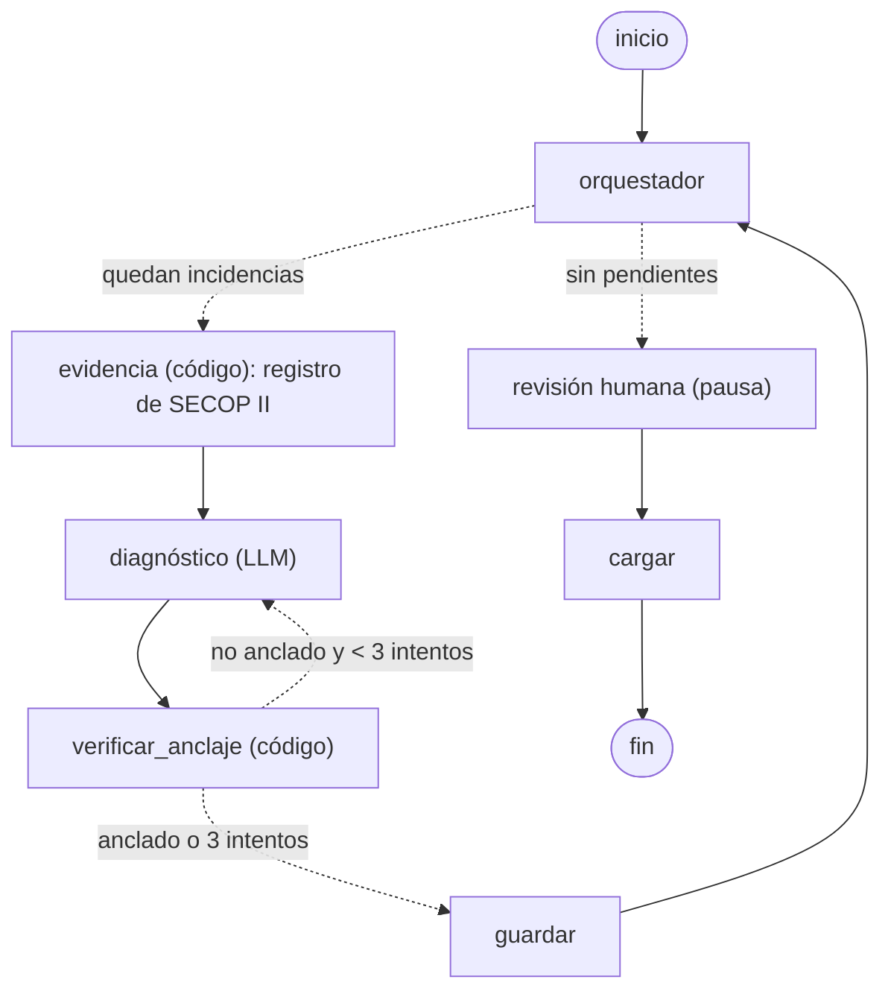

# Agente de incidencias — contratación pública funeraria en SECOP II

Agente del proyecto de consultoría (USTA). Revisa los procesos de contratación pública de
servicios funerarios publicados en SECOP II: detecta incidencias con reglas, toma como
evidencia el registro tal como está publicado en SECOP y diagnostica la causa citándolo.

## Cómo funciona



1. **Reglas (código, sin LLM)** — `agente/validaciones.py`:

   | Regla | Qué marca |
   | --- | --- |
   | `id_duplicado` | el mismo ID del proceso en más de una fila |
   | `posible_repetido` | otro proceso de la misma entidad con igual referencia, año y precio base |
   | `adjudicado_sin_valor` | figura adjudicado pero el valor adjudicado es $0 |
   | `precio_base_cero` | proceso activo con precio base $0 |
   | `adjudicacion_supera_base` | valor adjudicado más de 5 % por encima del precio base |
   | `precio_atipico` | precio base a más de 3,5 desviaciones robustas (log10, por modalidad) |
   | `categoria_no_definida` | sin código UNSPSC |
   | `clasificacion_por_validar` | el término funerario aparece, pero no está claro que sea la compra principal |

2. **Evidencia (código):** el registro de SECOP II del proceso (y los procesos parecidos, si los hay).
3. **Diagnóstico:** la causa es una de `error_de_registro`, `registro_duplicado`, `no_funerario`,
   `dato_plausible` o `indeterminado`. Los casos obvios (ID duplicado, adjudicado con $0, UNSPSC
   vacío, precio $0 fuera de solicitudes de información) los decide el **código**; el **modelo**
   decide los demás y redacta la conclusión.
4. **Anclaje (código):** la cita debe existir en el registro de SECOP y toda cifra de la conclusión
   debe estar en la evidencia. Si falla, el diagnóstico se repite hasta 3 veces.
5. **Revisión humana:** el grafo se detiene y pide aprobar o rechazar los casos de confianza media
   o baja antes de guardar.

## Datos

`data/secop/procesos_funerarios_secop.parquet`: 3.319 filas (3.138 procesos) de SECOP II,
2017–2026. Son los procesos de la base clasificada del equipo (`procesos_exequiales_clasificados.csv`),
traídos completos desde el CSV oficial de SECOP II con `scripts/extraer_secop.py`, porque la base
clasificada tenía filas partidas por saltos de línea dentro de los textos.

## Instalación

Python 3.12 y [Ollama](https://ollama.com) con Qwen 2.5 7B (gratis, local):

```powershell
py -3.12 -m venv .venv
.venv\Scripts\python.exe -m pip install langgraph openai pandas pyarrow pytest
ollama pull qwen2.5:7b
```

Para usar DeepSeek en vez de Qwen: `$env:LLM_BASE_URL="https://api.deepseek.com"; $env:LLM_MODEL="deepseek-chat"; $env:LLM_API_KEY="<clave>"`.
Para enviar trazas a Langfuse, instala `langfuse` y define `LANGFUSE_PUBLIC_KEY`, `LANGFUSE_SECRET_KEY`
y `LANGFUSE_HOST`. Sin Langfuse, cada llamada queda en `logs/trazas.jsonl`.

## Uso

```powershell
.venv\Scripts\python.exe correr.py --solo-detectar          # reglas sobre todos los procesos (segundos)
.venv\Scripts\python.exe correr.py --n 5                    # 5 incidencias al azar con el agente
.venv\Scripts\python.exe correr.py --una-por-regla          # una de cada tipo
.venv\Scripts\python.exe correr.py --n 5 --regla precio_atipico
.venv\Scripts\python.exe evaluar.py                         # 60 fallas sembradas, sin LLM
.venv\Scripts\python.exe evaluar.py --diagnosticar 18       # + diagnóstico del agente
.venv\Scripts\python.exe -m pytest
```

Salidas en `resultados/`: `incidencias_secop.csv`, `diagnosticos.csv`, `evaluacion_*.csv`, `grafo.mmd`.

## Resultados

Corridas del 8 de noviembre de 2026 con Qwen 2.5 7B local.

**Incidencias reales** (`correr.py --solo-detectar`): 1.170 en 3.138 procesos — 373 clasificaciones
por validar, 340 posibles repetidos, 181 IDs duplicados, 147 precios base en $0, 105 sin UNSPSC,
19 precios atípicos, 4 adjudicaciones por encima del precio base y 1 adjudicado con $0. Entre ellas,
valores imposibles como una adjudicación de $813.880.846.788.409 (CO1.REQ.1615047) y un precio base
de $4.796.410.000.000 (CO1.REQ.387286).

**Una incidencia real por regla** (`correr.py --una-por-regla --semilla 4`): 6 de 8 diagnósticos
quedaron anclados con confianza alta al primer intento; 2 pasaron a revisión humana.

**Fallas sembradas** (`evaluar.py --diagnosticar 18`, semilla 2026):

| Medida | Resultado | Umbral |
| --- | --- | --- |
| Detección | 60/60 = 100 % (IC95 % 94–100 %) | ≥ 90 % |
| Falsas alarmas | 0/60 = 0 % (IC95 % 0–6 %) | ≤ 10 % |
| Causa correcta, decidida por código | 9/9 (IC95 % 70–100 %) | — |
| Causa correcta, decidida por el modelo | 6/9 (IC95 % 35–88 %) | — |
| Anclaje verificado | 15/18 | 100 % |

El modelo falla sobre todo en precios inflados: dos veces llamó «dato plausible» a un precio
multiplicado por 1.000 o una adjudicación triplicada, y una vez devolvió una causa inválida.
Esos casos no se cargan solos: los que no quedan anclados pasan a revisión humana.

## Límites conocidos

- Con Qwen en CPU cada diagnóstico tarda de 30 a 70 s; para la evaluación se usan muestras.
- Las reglas se escribieron sabiendo qué fallas se sembrarían, así que la detección sobre fallas
  sembradas es optimista. La medida que importa es el acuerdo con la revisión humana.
- Que una cita exista no prueba que la conclusión sea correcta: la revisión humana sigue siendo necesaria.
- Se usa el precio base y el valor adjudicado publicados, sin adiciones ni modificaciones del contrato.
- El diseño original indica DeepSeek y Langfuse con Docker; aquí se usa Qwen local por costo.
- Uso de IA: el código se escribió con ayuda de Claude Code.
